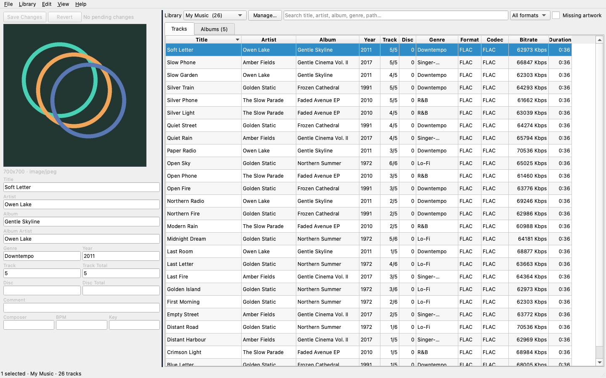

# TrackStash

TrackStash is a local-first media library manager for people who curate their own
music collections. It imports audio into a managed library, edits embedded tags
safely at scale, organizes files by metadata, and keeps the library index
consistent without cloud dependencies.



> **Status:** M6 implementation. Core managed-library, import, tag editing,
> artwork, organization, duplicate review, and deletion workflows are
> implemented. The app is not yet notarized for public distribution.

## Features

- **Managed library.** One current library at a time. Settings → Library embeds
  the library selector and identity panel plus adding, Quick/Full Scan,
  relocation, ReKey, enable/disable, and index removal. Imports copy by default
  or move on request from the top-bar Import… button. Destinations follow the
  organization template in Settings, which includes a Default reset and a
  copyable variable reference; tag overrides can be applied per import.
- **Track context menu.** Edit Tags, Go to Album, Open, Open with, Delete, and
  Show in Finder.
- **Tracks and Albums views.** The app opens on the album grid; a compact
  `View` switch in the top bar toggles between Albums and Tracks. The track
  table is sortable with movable/resizable columns (`Title`, `Format`, `Codec`,
  `Bitrate` in Kbps, and more). Album covers resize within a fixed-gap grid to
  fill the viewport; the grid sorts by date added descending by default and the
  sort field/order is configurable in Settings. Double-click an album to filter
  tracks; select multiple albums for batch editing. `Cmd+[` / `Ctrl+[` returns
  from a filtered album to the Albums grid.
- **Consistent Qt interface.** The app uses Qt's Fusion style and a menu-less
  action bar, so buttons, menus, and other controls share one appearance instead
  of mixing native macOS and Qt-drawn widgets. Settings and library actions are
  available from the gear button. The window remembers its size between launches.
  A status bar shows the active library and selection count; it is on by default
  and can be disabled in Settings. Numeric and dropdown controls ignore wheel
  input unless they have keyboard focus, preventing accidental changes while
  scrolling.
- **Configurable columns.** Right-click the track header to show or hide columns,
  auto-fit all widths, or drag sections. Order, width, and visibility persist and
  are also editable in Settings.
- **Tracks-compatible UUIDs.** Library, artist, album, and song IDs use the same
  deterministic MD5 algorithm as the Tracks macOS app and WebTracks.
- **Tag editing.** Edit directly in the left media editor; changed fields are
  highlighted and counted, and Save opens a preview before writing. Multi-track
  selections show shared values and italic `Multiple` placeholders, so one field
  can be applied to the whole selection. Batch edits and per-disc auto-numbering
  are also available from the track and album context menus.
- **Artwork.** View, embed, replace, remove, and extract front-cover artwork.
  Covers are read from embedded tags on demand for visible albums; there is no
  disk cover cache. New artwork is normalized to JPEG with Crop to square,
  Fit to square, or Original aspect ratio modes.
- **Organization.** Rename and move files with a token template, live preview,
  collision detection, UUID remapping, and journaling. Strong ordering is on by
  default: tag changes that affect the destination move the file immediately.
- **Editing safety.** File modification times are preserved by default when
  editing indexed files. Both strong ordering and mtime preservation can be
  changed in Settings.
- **Import.** A single Add Source control supports files or folders, accepts
  drag-and-drop into the import window, and previews automatically as soon as a
  source is chosen.
- **Library maintenance.** Quick and full scans, changed-file refresh, missing
  file review, duplicate review, and index-only or system-Trash deletion. The
  Settings → Library tab manages libraries, database backup, and duplicate review;
  selection-specific actions remain in the main window.
- **Local-first.** No online metadata lookup, telemetry, accounts, or cloud
  services. No playback or preview in v1.

## Requirements

- macOS 13 or newer
- [uv](https://docs.astral.sh/uv/)
- Python 3.12 (managed by uv)

PySide6 is pinned to **6.11.3** because its macOS wheel targets macOS 13.
PySide6 6.12 and later require macOS 14+. The v1 bundle is built for Apple
Silicon; a universal2 build for Intel Macs is a follow-up.

## Development

```bash
uv python install 3.12
uv sync
uv run trackstash
```

On first run TrackStash creates `~/Music/TrackStash` and stores its database in
`~/Library/Application Support/TrackStash/library.sqlite`.

TrackStash uses Qt's Fusion style and does not install a main menu bar. The
packaged `.app` and `uv run` development builds share the same in-window action
bar, dark/light palette support, and Settings gear.

Useful development flags:

```bash
uv run trackstash --database /tmp/trackstash.sqlite --no-default-library
uv run trackstash --smoke-test
```

Run the checks:

```bash
uv run ruff format --check .
uv run ruff check .
uv run mypy
uv run pytest
```

The test suite uses Qt's offscreen platform by default. Audio fixtures are
generated with `ffmpeg`; tests are skipped when it is unavailable.

### Real-library integration tests

The integration tests are opt-in and never modify the source folders:

```bash
TRACKSTASH_TEST_MUSIC="$HOME/Desktop/emptyAlbums" \
TRACKSTASH_TEST_M4A="/path/to/sample.m4a" \
uv run pytest -m integration
```

Only a handful of files are copied into a temporary library, then removed.

## Packaging

Build an ad-hoc signed macOS app bundle and DMG:

```bash
./packaging/macos/build_dmg.sh
```

Outputs:

- `dist/TrackStash.app`
- `dist/TrackStash.dmg`

The script uses PyInstaller, codesigns the bundle ad-hoc, and creates a
compressed DMG. Public distribution still requires a Developer ID certificate,
notarization, and stapling.

## Project layout

```text
src/trackstash/
  app.py                 QApplication bootstrap and CLI flags
  __main__.py            console entry point
  core/
    identity/            Tracks-compatible UUID generation
    metadata.py          mutagen read/write and canonical tags
    db.py                SQLite schema, upserts, journal, search
    library.py           import, scan, edit, organize, delete
    template.py          tag-driven path templates and sanitization
    compat/              compatibility notes and future shared helpers
  ui/                    PySide6 window, dialogs, table model
  platform/              platform-specific services
tests/                   pytest and pytest-qt tests
docs/                    requirements and compatibility documentation
packaging/macos/         PyInstaller spec and DMG build script
```

## Known limitations

- No online metadata lookup, audio playback, or preview.
- Playlist import is planned after M0 and is not implemented.
- Filesystem watching, saved views, tag presets, and automatic organization
  are not yet exposed in the UI.
- User-facing undo/redo is removed; operations apply immediately. System-Trash
  file deletion remains irreversible.
- The release DMG is ad-hoc signed, not notarized.

## Documentation

- [Requirements](docs/REQUIREMENTS.md)
- [Tracks/WebTracks compatibility](docs/COMPATIBILITY.md)
- [Implementation status](docs/IMPLEMENTATION_STATUS.md)

## License

TrackStash is free software licensed under the
[GNU General Public License v3.0 only](LICENSE). The corresponding source is
published with every binary release. Third-party notices are listed in
[THIRD_PARTY_NOTICES.md](THIRD_PARTY_NOTICES.md).
